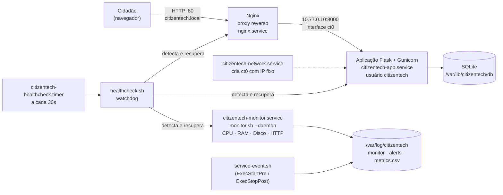

# CitizenTech · Infraestrutura Linux automatizada

**FIAP · Global Solution 2026.2 · Engenharia de Software (3º ano) · Operating Systems**

Infraestrutura Linux **provisionada 100% por Shell Script (Bash)** para hospedar a aplicação web
CitizenTech, com gerenciamento de serviços via **systemd**, configuração de **rede, IP e DNS**,
**monitoramento** de CPU / memória / disco com alertas, **logs de auditoria** e **testes de falha**
com recuperação automática.

```bash
git clone https://github.com/RafaelDuarteF/citizentech-linux-infra.git
cd citizentech-linux-infra
sudo ./install.sh          # provisiona tudo e valida (47 verificações automáticas)
```

---

## Integrantes

| Nome completo | RM |
|---|---|
| Vinicius Monteiro Araújo | RM555088 |
| Guilherme Almeida | RM555180 |
| Rafael Duarte de Freitas | RM558644 |
| Rafael Gaspar Bragança Martins | RM557228 |
| Luiz Gustavo da Silva | RM558358 |

> **Vídeo de demonstração (até 7 min):** _cole aqui o link do YouTube_

---

## Ficha da CitizenTech

| Campo | Resposta |
|---|---|
| **Nome da CitizenTech** | Zeladoria Cidadã |
| **Cidade e bairro** | São Paulo – _bairro escolhido pela equipe_ |
| **Cidadão beneficiado** | Moradores, pedestres, idosos e pessoas com deficiência que circulam pelo bairro |
| **Problema, em uma frase** | Buracos, lâmpadas apagadas, lixo e calçadas quebradas demoram a ser resolvidos porque não há um jeito simples de registrar e acompanhar o problema |
| **Como funciona** | O morador registra a ocorrência pelo site/app, todos acompanham a situação (aberta → em andamento → resolvida) |
| **O que esta parte faz (Operating Systems)** | Prepara, publica, monitora e mantém no ar o servidor Linux que hospeda a aplicação web |
| **Indicador de impacto** | Nº de ocorrências registradas e % resolvidas (endpoint `/api/estatisticas`); disponibilidade do serviço (`metrics.csv`) |
| **ODS conectados** | ODS 11 (Cidades e comunidades sustentáveis), ODS 9 (Indústria, inovação e infraestrutura), ODS 10 (Redução das desigualdades) |

> A equipe pode trocar a aplicação de exemplo pela aplicação desenvolvida nas outras disciplinas
> sem alterar os scripts – veja [Usando a aplicação da equipe](#usando-a-aplicação-da-equipe).

---

## Arquitetura



| Camada | Componente | Detalhe |
|---|---|---|
| Sistema | Ubuntu 24.04 (WSL2, VirtualBox ou Azure) | hostname `citizentech-srv`, fuso `America/Sao_Paulo`, journald persistente |
| Rede | interface `ct0` (IP fixo `10.77.0.10/24`) | criada a cada boot por `citizentech-network.service`; em VM também IP estático via netplan |
| DNS | `1.1.1.1` / `8.8.8.8` + nomes locais em `/etc/hosts` | `citizentech.local`, `app.citizentech.local`, teste e **rollback automático** se o DNS falhar |
| Publicação | Nginx :80 → `10.77.0.10:8000` | página amigável de manutenção (502) enquanto a aplicação se recupera |
| Aplicação | Flask + Gunicorn em virtualenv | usuário de sistema sem login, sandbox systemd (`ProtectSystem=strict`) |
| Monitoramento | `monitor.sh` como serviço | intervalo 15s, limites configuráveis, alertas e histórico CSV |
| Tolerância a falhas | `Restart=always` + `StartLimitBurst` + watchdog por timer | recupera de crash, parada manual, loop de falhas e travamento |
| Auditoria | `audit.log` + journald (`citizentech-audit`) | quem executou, o quê, quando e resultado de cada etapa |

---

## Mapa dos critérios de avaliação

| Critério (pontos) | Onde está | Como demonstrar |
|---|---|---|
| Provisionamento de infra – redes, DNS, IP (2) | [`scripts/01-provision-infra.sh`](scripts/01-provision-infra.sh), [`scripts/ct-network.sh`](scripts/ct-network.sh), [`systemd/citizentech-network.service`](systemd/citizentech-network.service) | `sudo ./scripts/01-provision-infra.sh` · `ip -br addr` · `getent hosts citizentech.local` |
| Provisionamento da aplicação – dependências, configurações, orquestração (2) | [`scripts/02-provision-app.sh`](scripts/02-provision-app.sh), [`systemd/citizentech-app.service`](systemd/citizentech-app.service), [`nginx/citizentech.conf`](nginx/citizentech.conf) | `sudo ./scripts/02-provision-app.sh` · navegador em `http://localhost/` |
| Monitoramento com alertas de CPU, disco e memória (2) | [`scripts/monitor.sh`](scripts/monitor.sh) | `sudo ct-monitor` · `sudo ./scripts/fault-tests.sh cpu-stress` |
| Monitoramento como serviço tolerante a falhas (1) | [`systemd/citizentech-monitor.service`](systemd/citizentech-monitor.service), [`scripts/healthcheck.sh`](scripts/healthcheck.sh), [`systemd/citizentech-healthcheck.timer`](systemd/citizentech-healthcheck.timer) | `sudo ./scripts/fault-tests.sh kill-monitor` / `stop-monitor` / `crash-loop` |
| Logs de auditoria e execução dos scripts (1) | [`scripts/lib/common.sh`](scripts/lib/common.sh), [`scripts/service-event.sh`](scripts/service-event.sh) | `sudo tail /var/log/citizentech/audit.log` · `journalctl -t citizentech-audit` |
| Funcionamento completo (2) | [`install.sh`](install.sh), [`scripts/04-validate.sh`](scripts/04-validate.sh), [`scripts/fault-tests.sh`](scripts/fault-tests.sh) | `sudo ./install.sh` → 47/47 PASS · `sudo ./scripts/fault-tests.sh all` |

---

## Estrutura do repositório

```text
citizentech-linux-infra/
├── install.sh                      # provisiona TUDO em ordem (01 → 02 → 03 → 04)
├── config/
│   └── citizentech.conf            # ÚNICO lugar para alterar hostname, IP, DNS, limites, app...
├── scripts/
│   ├── lib/common.sh               # logging, auditoria, tratamento de erros, utilitários
│   ├── 01-provision-infra.sh       # hostname, IP, DNS, usuários, sudoers, diretórios, logs, firewall
│   ├── 02-provision-app.sh         # runtime, código, variáveis de ambiente, permissões, systemd, Nginx
│   ├── 03-provision-monitoring.sh  # instala monitor + watchdog como serviços systemd
│   ├── 04-validate.sh              # 47 verificações automáticas PASS/FAIL
│   ├── monitor.sh                  # monitoramento de CPU, RAM, disco e aplicação (alertas)
│   ├── healthcheck.sh              # watchdog: detecta e recupera serviços
│   ├── service-event.sh            # registra início/parada/falha/recuperação dos serviços
│   ├── ct-network.sh               # cria a interface de serviço ct0 com IP fixo
│   ├── fault-tests.sh              # testes de falha controlados
│   ├── collect-evidence.sh         # gera evidências técnicas em evidencias/
│   └── uninstall.sh                # remove o ambiente (para reprovisionar do zero)
├── systemd/                        # units: app, monitor, healthcheck (.service/.timer), rede, drop-in nginx
├── nginx/                          # proxy reverso + página de manutenção
├── app/                            # aplicação web CitizenTech (Flask)
├── evidencias/                     # capturas de tela e saídas dos comandos
├── docs/roteiro-video.md           # roteiro do vídeo de 7 minutos
└── prompts.md                      # registro do uso de IA (combinado da GS)
```

---

## Como reproduzir o ambiente

Requisitos: Ubuntu 22.04/24.04 (ou Debian 12) com **systemd**, acesso à internet e `sudo`.

### Opção 1 – WSL (Windows 10/11)

No **PowerShell**, crie uma distribuição dedicada ao projeto (não interfere no seu Ubuntu atual):

```powershell
wsl --install Ubuntu-24.04 --name CitizenTech
wsl -d CitizenTech
```

Dentro do Linux:

```bash
sudo apt-get update && sudo apt-get install -y git
git clone https://github.com/RafaelDuarteF/citizentech-linux-infra.git
cd citizentech-linux-infra
sudo ./install.sh
```

Abra **http://localhost/** no navegador do Windows.

O script configura no `/etc/wsl.conf`: `systemd=true`, `hostname=citizentech-srv`,
`generateHosts=false` (mantém o `/etc/hosts` do projeto) e `generateResolvConf=false`
(mantém o DNS do projeto). Para confirmar que tudo volta sozinho depois de reiniciar:

```powershell
wsl --terminate CitizenTech
wsl -d CitizenTech
```

```bash
sudo ./scripts/fault-tests.sh reboot-check
```

> **Atenção (comportamento do WSL):** o Windows desliga a distribuição alguns segundos depois que
> o último terminal dela é fechado – e com ela os serviços. Durante a demonstração mantenha um
> terminal da distro aberto. Ao reabrir, o systemd sobe tudo sozinho (é exatamente o que o
> `reboot-check` comprova).

### Opção 2 – Máquina virtual (VirtualBox) ou Azure

1. Crie uma VM **Ubuntu Server 24.04** (2 vCPU, 2 GB RAM, 20 GB disco).
   - **VirtualBox:** placa 1 em *NAT* (internet) e placa 2 em *Host-only* (IP fixo para acesso do host).
   - **Azure:** VM B1s/B2s, libere as portas **22** e **80** no NSG.
2. (VirtualBox) Para IP estático na placa host-only, edite `config/citizentech.conf`:
   ```bash
   NET_MODE="static"; NET_IFACE="enp0s8"; NET_ADDRESS="192.168.56.10/24"; NET_GATEWAY=""
   ```
   No Azure mantenha `NET_MODE="dhcp"` (o IP é gerenciado pela plataforma).
3. Execute:
   ```bash
   git clone https://github.com/RafaelDuarteF/citizentech-linux-infra.git
   cd citizentech-linux-infra && sudo ./install.sh
   ```
4. Acesse `http://192.168.56.10/` (VirtualBox) ou `http://<IP-público>/` (Azure).
   Em VM o firewall `ufw` é ativado liberando somente SSH (22) e HTTP (80).

### Execução por etapas

```bash
sudo ./scripts/01-provision-infra.sh        # infraestrutura
sudo ./scripts/02-provision-app.sh          # aplicação
sudo ./scripts/03-provision-monitoring.sh   # monitoramento
sudo ./scripts/04-validate.sh               # validação
```

Todos os scripts são **idempotentes**: podem ser executados novamente a qualquer momento
(ex.: depois de alterar `config/citizentech.conf`) sem duplicar configurações.

---

## O que cada script configura

### 01 – Infraestrutura (`01-provision-infra.sh`)

| Etapa | O que faz |
|---|---|
| Pré-requisitos | Verifica root, Ubuntu/Debian, systemd como PID 1, conectividade; detecta WSL / VM / Azure |
| Pacotes base | `curl git jq rsync acl bind9-dnsutils net-tools htop sysstat stress-ng logrotate` (+ `ufw` em VM) – instala só o que falta e registra versão de cada pacote |
| Usuários e permissões | grupo `citizentech-ops`; usuário de sistema `citizentech` (sem login); operador `ctops`; `/etc/sudoers.d/citizentech` (validado com `visudo`) permitindo aos operadores **somente** gerenciar os serviços do projeto |
| Diretórios | `/opt/citizentech` (código), `/etc/citizentech` (config), `/var/lib/citizentech` (dados), `/var/log/citizentech` (logs), cada um com dono e modo definidos |
| Variáveis de ambiente | `/etc/profile.d/citizentech.sh` (`CITIZENTECH_HOME`, `CITIZENTECH_LOGS`, `PATH`) |
| Nomes locais | bloco gerenciado no `/etc/hosts`: `citizentech-srv`, `citizentech.local`, `app.citizentech.local → 10.77.0.10` |
| Hostname e fuso | `citizentech-srv` (`hostnamectl` ou `wsl.conf`) e `America/Sao_Paulo` |
| Rede / IP | interface `ct0` com IP fixo `10.77.0.10/24` recriada no boot por `citizentech-network.service`; na VM, IP estático via netplan **com validação e rollback** |
| DNS | `1.1.1.1` e `8.8.8.8` (systemd-resolved na VM, `resolv.conf` no WSL), teste de cada servidor e **rollback** se a resolução falhar |
| Logs | `logrotate` diário (14 dias), journald persistente (logs sobrevivem ao reboot) |
| Firewall | `ufw`: bloqueia entrada, libera 22 e 80 (VM/Azure) |

### 02 – Aplicação (`02-provision-app.sh`)

| Etapa | O que faz |
|---|---|
| Runtime | `python3 python3-venv python3-pip sqlite3` (ou `nodejs npm` / `dotnet-sdk-8.0`) + `nginx` |
| Código | publica `app/` (ou clona o repositório git da equipe) em `/opt/citizentech/app` e grava `.deploy-info` |
| Variáveis de ambiente | `/etc/citizentech/app.env` (modo **600**): `APP_ENV`, `APP_HOST`, `APP_PORT`, `DATABASE_PATH`, `LOG_DIR`, `SECRET_KEY` (gerada com `openssl rand` e preservada nas reexecuções)… |
| Dependências | virtualenv em `/opt/citizentech/venv` + `pip install -r requirements.txt` (versões registradas no log) |
| Permissões | código `root:citizentech 750` (a aplicação **lê mas não altera** o próprio código); banco `citizentech 750`; segredos `root 600` |
| Serviço | `citizentech-app.service`: usuário `citizentech`, `Restart=always`, sandbox (`ProtectSystem=strict`, `NoNewPrivileges`, `PrivateTmp`), habilitado no boot |
| Publicação | Nginx como proxy reverso (`nginx -t` antes de aplicar), drop-in `Restart=on-failure` para o próprio Nginx |
| Testes | aguarda `/health` responder e testa `http://citizentech.local/` via Nginx |

### 03 – Monitoramento (`03-provision-monitoring.sh`)

Instala `monitor.sh` e `healthcheck.sh` em `/opt/citizentech/bin` (atalhos `ct-monitor` e
`ct-healthcheck`), as units `citizentech-monitor.service`, `citizentech-healthcheck.service` e
`citizentech-healthcheck.timer`, valida com `systemd-analyze verify`, habilita no boot e confirma
que o monitor já está registrando.

---

## Monitoramento

```bash
sudo ct-monitor            # painel no terminal
sudo ct-monitor --json     # saída em JSON
journalctl -u citizentech-monitor -f
```

```text
 CitizenTech Monitor  host=citizentech-srv  12/11/2026 00:39:12
 RECURSO         USO                                  LIMITES      STATUS
 CPU              0%  ..............................  70/90%       OK   load=0.65 (12 CPUs)
 Memória RAM      5%  #.............................  75/90%       OK   livre=11396MB de 11961MB, swap=0%
 Disco /          1%  ..............................  80/90%       OK   livre=954.0GB de 1006.9GB
 Aplicação            http://10.77.0.10:8000/health                UP
 Status geral: OK
```

| Recurso | Como é medido | Aviso | Crítico |
|---|---|---|---|
| CPU | amostragem de `/proc/stat` (+ load average) | 70% | 90% |
| Memória RAM | `MemAvailable` de `/proc/meminfo` (+ swap) | 75% | 90% |
| Disco | `df` em cada ponto de `DISK_MOUNTS` | 80% | 90% |
| Aplicação | `GET /health` no IP de serviço | – | DOWN |

Limites e intervalo ficam em `config/citizentech.conf` e aceitam sobrescrita pontual
(`sudo CPU_WARN=50 ct-monitor`). Ao ultrapassar um limite o monitor:

1. grava o alerta em `alerts.log` com os **3 processos que mais consomem** o recurso;
2. envia ao journald com prioridade `warning`/`crit` (`journalctl -t citizentech-alert`);
3. quando o recurso volta ao normal, registra **RESOLVIDO**.

### Serviço tolerante a falhas

| Situação | Quem resolve | Como |
|---|---|---|
| Processo morre (crash, `kill -9`) | systemd | `Restart=always`, `RestartSec=5` |
| Loop de falhas | systemd → watchdog | `StartLimitBurst=5` em 120s marca `failed`; o watchdog faz `reset-failed` e inicia |
| Parada manual (`systemctl stop`) | watchdog | `citizentech-healthcheck.timer` a cada 30s detecta e inicia |
| Monitor travado (vivo, sem registrar) | watchdog | heartbeat em `/var/lib/citizentech/state` mais antigo que 3 intervalos → restart |
| Aplicação viva mas sem responder | watchdog | 2 falhas seguidas no `/health` → restart |
| Reinicialização da máquina | systemd | todas as units `enabled` (`WantedBy=multi-user.target` / `timers.target`) |
| Manutenção planejada | operador | `sudo touch /etc/citizentech/maintenance` suspende a recuperação automática |

```bash
sudo systemctl start|stop|restart|status citizentech-monitor
sudo systemctl list-timers 'citizentech-*'
```

---

## Logs e auditoria

Todos em **`/var/log/citizentech/`** (dono `root:citizentech-ops`, modo 640, rotação diária):

| Arquivo | Conteúdo |
|---|---|
| `audit.log` | **Trilha de auditoria**: data, run-id, host, usuário (inclusive quem usou `sudo`), script, ação, resultado `OK/FAIL`, detalhe |
| `provision.log` | passo a passo dos provisionamentos, incluindo cada pacote instalado e sua versão |
| `commands.log` | saída bruta dos comandos executados (apt, pip, netplan…) |
| `errors.log` | somente erros: script, linha, comando e código de saída |
| `monitor.log` | cada verificação do monitor |
| `alerts.log` | alertas `WARN`/`CRIT` e `RESOLVIDO` |
| `metrics.csv` | histórico das métricas (abre em planilha) |
| `healthcheck.log` | execuções do watchdog, falhas detectadas e recuperações |
| `service-events.log` | início, parada, **FALHA** e **RECUPERAÇÃO** de cada serviço (dados do próprio systemd) |
| `fault-tests.log` | resultados dos testes de falha |
| `app/access.log` | acessos à aplicação |

Linhas copiadas de uma execução real (ambiente de referência WSL2):

```text
# audit.log - falha controlada registrada com script, linha, comando e código de saída
2026-11-12T00:42:08-0300 | run=falha-004207 | host=citizentech-srv | user=root | script=falha-controlada.sh | acao=Copiar configuração obrigatória (falha proposital) | resultado=FAIL | detalhe=local=fault-tests.sh:39 exit=1 comando=cp "$CT_ETC/parametros-inexistentes.conf" /tmp/citizentech-teste.conf

# alerts.log - CPU acima do limite crítico, com os processos responsáveis, e a volta ao normal
2026-11-12T00:47:53-0300 [CRIT] host=citizentech-srv recurso=cpu valor=100% limite_aviso=70% limite_critico=90% detalhe="load=2.22 top: stress-ng-cpu(pid 3550, 102%), stress-ng-cpu(pid 3554, 102%), stress-ng-cpu(pid 3545, 102%)"
2026-11-12T00:40:50-0300 [RESOLVIDO] host=citizentech-srv recurso=cpu valor=0% anterior=CRIT

# service-events.log - processo morto com SIGKILL e recuperação automática pelo systemd
2026-11-12T00:39:20-0300 [ERROR] [systemd] [run=20261112-003920-1866] FALHA: citizentech-monitor.service terminou de forma anormal (result=signal code=killed status=KILL)
2026-11-12T00:39:25-0300 [WARN] [systemd] [run=20261112-003925-1903] RECUPERACAO: citizentech-monitor.service sendo reiniciado após falha (result=signal status=KILL) | reinícios automáticos: 1

# healthcheck.log - parada manual detectada e recuperada pelo watchdog
2026-11-12T00:39:43-0300 [ERROR] [healthcheck] [run=20261112-003943-2106] ALERTA: citizentech-monitor.service está 'inactive' - iniciando recuperação automática
2026-11-12T00:39:43-0300 [OK] [healthcheck] [run=20261112-003943-2106] RECUPERADO: citizentech-monitor.service ativo novamente (PID 2170)
```

Também no journald:

```bash
journalctl -t citizentech-audit        # auditoria
journalctl -t citizentech-alert        # alertas de consumo
journalctl -u 'citizentech-*' --since today
```

---

## Testes de falha

```bash
sudo ./scripts/fault-tests.sh all            # bateria completa (~5 min)
sudo ./scripts/fault-tests.sh <cenário>      # um cenário
```

| Cenário | Simulação | Resultado esperado (verificado pelo script) |
|---|---|---|
| `kill-monitor` | `kill -9` no processo do monitor | systemd reinicia em ~5s; `service-events.log` registra FALHA e RECUPERAÇÃO |
| `stop-monitor` | `systemctl stop` manual | watchdog detecta em até 30s e recupera |
| `crash-loop` | derruba o monitor repetidamente | systemd marca `failed (start-limit-hit)`; watchdog faz `reset-failed` e recupera |
| `kill-app` | `kill -9` na aplicação | Nginx mostra página de manutenção (502) por ~4s; systemd reinicia; HTTP 200 volta |
| `cpu-stress` | `stress-ng` em todos os núcleos por 45s | alertas `CRIT` de CPU com processos responsáveis, depois `RESOLVIDO` |
| `mem-stress` | aloca memória até ~80% por 45s | alertas de memória, depois `RESOLVIDO` |
| `disk-alert` | ocupa o disco com `fallocate` (VM) ou reduz o limite temporariamente (discos grandes/WSL) | alerta de disco, depois `RESOLVIDO` |
| `script-error` | script copia arquivo inexistente; monitor com configuração inválida | erro com script, linha, comando e código em `errors.log`, `audit.log` e journald |
| `reboot-check` | executar após reiniciar a VM/WSL | todas as units habilitadas e ativas; eventos `BOOT` registrados |

Resultado da execução no ambiente de referência (WSL2, Ubuntu 24.04): ver [`evidencias/`](evidencias/).

---

## Operação do dia a dia

```bash
systemctl status citizentech-app citizentech-monitor nginx --no-pager
sudo ct-monitor
sudo ./scripts/04-validate.sh
sudo tail -f /var/log/citizentech/{audit,alerts,errors}.log
curl -s http://citizentech.local/health
curl -s http://citizentech.local/api/info      # variáveis de ambiente em uso (sem segredos)

# como operador (sem ser root): só gerencia os serviços do projeto
sudo -iu ctops
sudo systemctl restart citizentech-app
```

Coletar evidências em texto (vão para `evidencias/coleta-<data>/`):

```bash
sudo ./scripts/collect-evidence.sh
```

Remover tudo para reprovisionar do zero:

```bash
sudo ./scripts/uninstall.sh --yes --purge && sudo ./install.sh
```

---

## Usando a aplicação da equipe

A aplicação de exemplo (`app/`) pode ser trocada pela aplicação desenvolvida nas disciplinas de
SOA/C#/Mobile **sem mudar nenhum script** – só a configuração:

```bash
# config/citizentech.conf
APP_SOURCE="git"
APP_GIT_URL="https://github.com/<organizacao>/<repositorio-da-api>.git"
APP_GIT_BRANCH="main"
APP_SUBDIR=""                 # subpasta da aplicação dentro do repositório, se houver
APP_RUNTIME="dotnet"          # python | node | dotnet
APP_HEALTH_PATH="/health"     # rota que responde 200 (ex.: "/" ou "/swagger/index.html")
APP_EXTRA_ENV=( "ConnectionStrings__Default=Data Source=/var/lib/citizentech/db/app.db" )
```

```bash
sudo ./scripts/02-provision-app.sh && sudo ./scripts/04-validate.sh
```

A aplicação recebe `HOST`/`PORT` (Node), `ASPNETCORE_URLS` (.NET) ou o bind do Gunicorn (Python)
apontando para `10.77.0.10:8000`, e o Nginx continua publicando na porta 80.

---

## Segurança aplicada

- Aplicação executa com usuário de sistema **sem shell** e sem permissão de escrita no próprio código.
- Segredos (`SECRET_KEY`) só em `/etc/citizentech/app.env` com modo **600**; nunca versionados (`.gitignore`).
- Sandbox systemd: `ProtectSystem=strict`, `ProtectHome`, `PrivateTmp`, `NoNewPrivileges`, `ReadWritePaths` mínimos.
- Aplicação escuta apenas no IP interno; somente o Nginx fica exposto (cabeçalhos de segurança, `server_tokens off`).
- `sudo` restrito para operadores (somente serviços `citizentech-*`), validado com `visudo -c`.
- Firewall `ufw` em VM/Azure: entrada bloqueada exceto 22 e 80.
- Somente **dados simulados** na aplicação (nenhum dado pessoal real).
